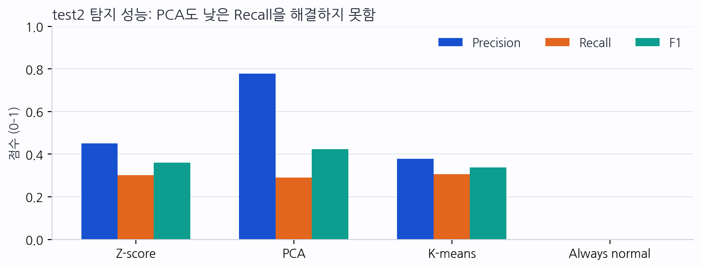
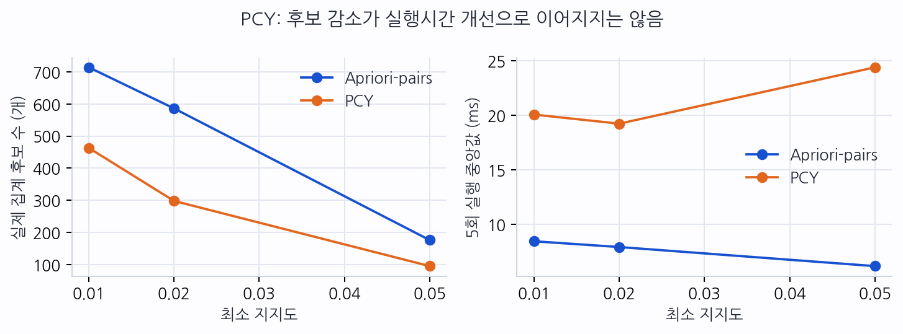
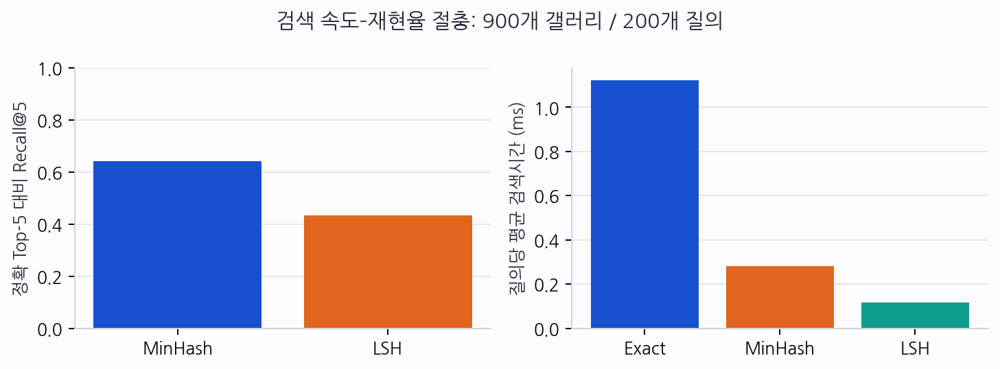
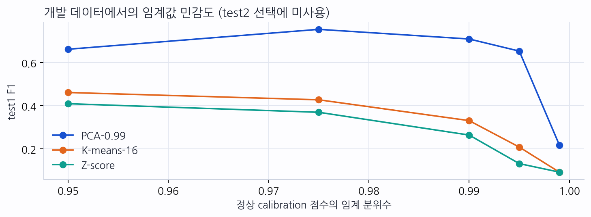
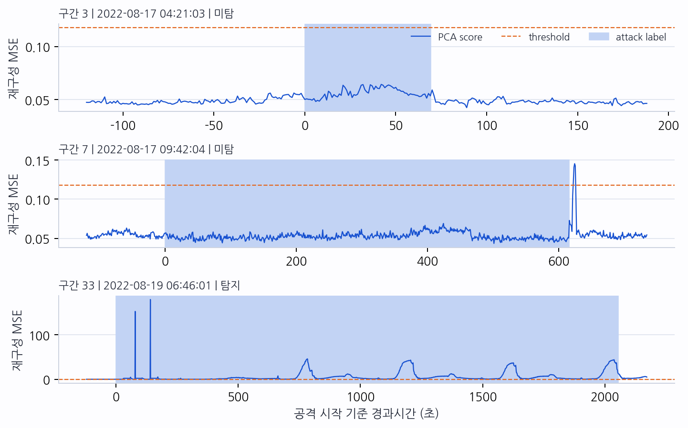

# HAI 산업제어 시계열의 공격 이상 탐지와 패턴 분석

SCE331 Data Mining 팀 프로젝트 | [팀 번호 입력 필요] | 2026-11-16 실험 기준

팀원: [이름·학번 입력 필요] / [이름·학번 입력 필요] / [이름·학번 입력 필요]

GitHub: [GitHub URL 입력 필요]
재현 코드 commit: [제출 코드 버전의 전체 40자리 commit hash 입력 필요]

## Abstract

산업제어 시스템의 센서·제어 기록만으로 공격 이상을 발견하고, 관련 상태 조합과 유사 운전 사례를 설명할 수 있는지 평가하였다. 실제 HAI 23.05의 정상 train1 280,800초, 개발 test1 54,000초, 최종 test2 230,400초를 사용하였다. PCA와 K-means로 이상을 탐지하고, Apriori·PCY로 빈발 상태쌍을 분석했으며, MinHash·LSH로 60초 창의 Jaccard 유사 검색을 수행하였다. 모델 적합과 표준화는 정상 학습 구간에서만 수행하고, test1에서 선택한 설정을 고정해 test2를 평가하였다.

test2에서 PCA는 Precision 0.779, Recall 0.290, F1 0.423으로 Z-score 기준 모델의 F1 0.361보다 높았지만, 공격 구간 38개 중 13개만 탐지하였다. PCY는 지지도 2%에서 집계 후보를 586개에서 298개로 줄였으나 실행시간은 개선하지 못했다. MinHash와 LSH의 정확 Top-5 대비 Recall@5는 각각 0.641과 0.432였다. 결과는 탐지의 오탐·미탐 절충과 검색의 속도·재현율 절충을 보여주며, 레이블 시각 정밀도 및 학습 운전상태 범위의 한계가 남는다.

## 1. Introduction

HAI는 실제 제어장치와 HIL 시뮬레이터를 결합한 테스트베드의 정상·공격 운전 기록이다[1], [2]. 본 연구는 네트워크 패킷이나 공격자 식별 정보 없이 86개 측정·제어 변수를 사용한다. 공격 명령이 물리 과정에 미친 영향과 정상 운전변화가 센서 공간에서 비슷하게 보일 수 있어 단순 정확도만으로 성능을 평가하기 어렵다. 또한 탐지만으로는 운영자가 관련 상태를 이해하거나 과거 사례를 찾기 어렵다는 문제가 있다.

연구 질문은 세 가지다. 첫째, 정상 데이터에서 학습한 PCA·K-means가 단순 통계 기준보다 유용한가? 둘째, 공격창과 함께 관측되는 센서상태 쌍이 다른 날짜에도 유지되는가? 셋째, MinHash·LSH가 정확 Jaccard 검색의 이웃을 어느 정도 보존하면서 검색량을 줄이는가? 각각을 탐지·해석·검색 과제로 분리해 평가하며 인과적 공격 원인이나 현장 배포 성능은 주장하지 않는다.

---

# 2. Data acquisition and preprocessing

## 2.1 원출처, 획득 및 실제 규모

원제공자 공식 GitHub의 HAI 23.05를 사용하였다[1]. 2026-11-16에 원본 저장소 commit 2a814cebc9a66b06c9e5cd545e2d72e65d383737의 Git LFS 실제 내용을 GitHub media 경로로 내려받았다. HAIEnd 225변수 자료와 구별해 HAI 86변수 자료를 선택하였다. 파일별 bytes·SHA-256은 results/data_manifest.json에 보존한다. 원본 CSV는 재배포하지 않으며 재다운로드 명령을 제공한다.

| 파일 / 역할 | 행 수 | 시간 / 공격 |
| --- | --- | --- |
| hai-train1 / 정상 학습 | 280,800 | 78시간 / 정상 |
| hai-test1 / 개발 | 54,000 | 15시간 / 2,981초 |
| hai-test2 / 최종 평가 | 230,400 | 64시간 / 8,403초 |
| label-test1 / 정답 | 54,000 | 14개 연속 공격구간 |
| label-test2 / 정답 | 230,400 | 38개 연속 공격구간 |

각 측정 파일은 timestamp와 86개 수치 열로 구성된다. P1/P2/P3 공정 및 P4 HIL 관련 신호, 센서·액추에이터·제어 값이 섞여 있다[1]. 변수명만으로 모든 열의 물리량·단위를 확정하지 않았다. 세 측정 파일에서 결측, timestamp 중복, 1초 간격 위반은 모두 0이었다. 공격 비율은 test1 5.520%, test2 3.647%이다. test2를 항상 정상으로 분류해도 Accuracy는 96.353%이므로 Accuracy 단독 평가는 부적절하다.

## 2.2 레이블 정렬의 예외와 검증

test1 측정·레이블 timestamp는 전체 행에서 초 단위로 일치하였다. 반면 공개 label-test2는 시각이 분 단위라 226,559개 중복 timestamp가 있었다. 이를 키로 다대다 병합하지 않았다. 측정·레이블 행 수가 230,400개로 같고, 모든 행에서 측정 timestamp의 분 내림값이 레이블 시각과 같은지 검사한 뒤 행 순서로 대응시켰다. 이는 배포 파일의 순서가 보존됐다는 가정이며 분 내부의 초 순서를 독립적으로 증명하지는 못한다. 원제공자 확인 전까지 본 결과의 명시적 한계로 유지한다.

## 2.3 적합 구간과 변환

시간순으로 train1의 앞 60%인 168,480행을 모델 적합에, 뒤 40%인 112,320행을 정상 점수 calibration에 사용하였다. 결측 대체용 중앙값, 평균과 표준편차는 적합 구간에서만 계산하였다. 관측 결측은 없었고, z=(x−μ)/σ를 공통 수치 표현으로 사용하였다. 적합 구간에서 상수인 21개 변수는 σ=1로 유지해 추후 변화가 사라지지 않게 했지만, 변화량이 원단위 크기에 영향을 받는 한계가 있다. label과 timestamp는 모델 입력에서 제외하였다.

---

# 3. Methods — 이상 탐지

## 3.1 전체 분석 구조와 구분

자료 확보 → 연속성·정답 대응 검사 → 정상 적합/보정 분할 → 정상 기준 표준화 이후 세 갈래로 분석하였다. 탐지 분기는 초 단위 수치 벡터로 이상 점수를 계산한다. 해석·검색 분기는 60초 비중첩 창을 부호 있는 항목집합으로 바꾼다. 출력은 탐지 지표, 공격 관련 상태쌍, 유사 이웃과 검색 비용으로 각각 평가한다. 교재의 주요 알고리즘 원리를 따르되[3], 목적이 다른 출력에 같은 평가 점수를 강제 적용하지 않았다.

## 3.2 PCA 재구성오차 탐지

정상 적합 행렬의 공분산을 NumPy 고유분해로 분해하고[4], 고유값 내림차순 누적 설명분산이 0.90, 0.95, 0.99에 도달하는 성분 수를 후보로 삼았다. 표준화 벡터 z와 선택 고유벡터 행렬 V에 대해 s(z)=‖z−VVᵀz‖²/86을 이상 점수로 사용하였다. 구현은 ‖z‖²−‖Vᵀz‖²을 계산하고 부동소수 오차로 생긴 음수는 0으로 제한한다. PCA를 시각화나 다른 모델의 전처리로만 쓰지 않고 자체 임계값·탐지 결과를 가진 독립 탐지기로 평가하였다.

이는 정상 상태가 낮은 차원의 선형 상관구조로 설명된다는 가정이다. 정상 부분공간에서 벗어나는 변화에는 유리하지만, 주요 정상 변동 방향을 따르는 공격이나 정상 잡음과 구분하기 어려운 약한 변화에는 취약할 수 있다. 시차·기울기 등 동적 특징은 추가하지 않았으므로 장기 시간 의존성을 직접 학습하는 모델은 아니다.

## 3.3 K-means 중심 거리 탐지

정상 적합 구간에서 seed 331로 최대 30,000행을 균등 무복원 추출하고 k=4, 8, 16을 비교하였다. 서로 다른 데이터 행을 무작위 중심으로 초기화한 뒤 최근접 중심 배정과 평균 중심 갱신을 반복한다. 최대 반복은 40회, 중심 좌표의 최대 절대 변화가 10⁻⁵ 미만이면 중단한다. 빈 군집은 직전 중심을 유지한다. 초기화는 한 번이며 k-means++ 또는 전역 최적해를 사용한 것으로 기술하지 않는다. 이상 점수는 가장 가까운 중심까지의 제곱 유클리드 거리다.

여러 정상 운전 상태를 중심 여러 개로 나타낼 수 있으나, 구형 군집과 유클리드 거리 가정, 무작위 초기값 및 운전 상태의 표본 범위에 의존한다. 학습 행 추출은 계산량 제한 목적이며 PCA는 모든 적합 행을 사용했으므로 학습 비용까지 동일한 비교는 아니다.

## 3.4 Baselines

Always normal은 모든 초에 정상(0)을 출력한다. Z-score 기준은 변수별 |z|의 최대값을 점수로 사용하고 학습·임계값 선택 규칙을 제안 탐지기와 공유한다. 전자는 불균형 정확도의 함정을, 후자는 복잡한 기법 없이 얻는 통계 기준 성능을 보여준다. 두 기준을 수업의 필수 주요 알고리즘 개수에 넣지 않는다.

---

# 3. Methods — 연관 패턴과 유사 검색

## 3.5 60초 창의 이산 항목집합

연속 60초 비중첩 창마다 변수별 평균 z를 계산한다. 절댓값이 1.5 이상인 값 중 최대 8개를 선택하고 부호에 따라 “변수=HIGH/LOW” 항목을 만든다. 물리적 안전 기준 초과가 아니라 정상 적합 평균 대비 상대 상태다. 개발 900창과 test2 3,840창이 생성됐으며 관측된 빈 집합은 없었다. 창의 공격 레이블은 포함된 초 중 하나라도 공격이면 1이다. 60초 평균은 순간 공격을 희석하고 긴 지속 상태를 강조한다.

## 3.6 Apriori와 PCY

Apriori는 부분집합의 지지도가 상위 집합보다 작을 수 없다는 성질을 이용한다[3]. 본 구현은 빈발 단일항목을 먼저 찾고, 이들로 이루어진 관측 후보쌍만 정확 집계한다. 3항목 이상의 일반 반복 확장은 하지 않으므로 “Apriori-pairs”로 표기한다. 최소 지지도는 0.01, 0.02, 0.05이고 빈도 경계는 ceil(지지도×창 수)다. 후보 수는 가능한 전체 조합 수가 아니라 실제 집계한 서로 다른 쌍의 수다.

PCY는 첫 패스에 항목쌍을 1,024개 버킷으로 해시해 빈도를 합산하고, 두 번째 패스에서 단일항목 빈도와 빈발 버킷 조건을 통과한 쌍만 집계한다[3]. 충돌은 추가 후보를 남길 수 있지만 정확 재집계 때문에 최종 빈발쌍을 바꾸면 안 된다. 세 지지도 모두 Apriori 출력과 완전히 같은지 assert했다. 해당 구현은 정수 버킷 배열로 빈발 버킷 조건을 검사하며 압축 비트맵 메모리 이득을 실측한 것은 아니다.

개발 자료에서 지지도 2% 빈발쌍을 고정하고, 쌍 ⇒ 공격창 규칙의 confidence=P(공격창|쌍), lift=confidence/P(공격창)를 계산한다. 개발 lift, 빈도 순으로 10개를 고른 뒤 test2에서 그대로 확인했다. 이는 레이블을 이용하는 사후 연관 분석이며 탐지기의 비지도 입력에 공격 레이블을 넣은 것이 아니다. 상관성과 인과적 공격 원인을 구분한다.

## 3.7 MinHash와 LSH

MinHash는 64개 affine modular 해시 h(x)=(ax+b) mod 2,147,483,647의 집합 내 최소값을 서명으로 삼고 서명 일치율로 Jaccard를 근사한다[3]. seed는 331이며 정확한 독립 순열 대신 실용적 근사 해시족을 사용한다. LSH는 64행을 16개 band×4행으로 나누고 동일 band가 있는 갤러리 창을 후보로 합친다. 후보는 정확 Jaccard로 다시 정렬하며 5개 미만일 때 전수검색으로 보충하지 않는다. MinHash와 LSH는 연관된 구성요소이므로 수업상 별도 알고리즘 인정 여부를 자동 가정하지 않는다.

---

# 4. Experimental design and evaluation

## 4.1 분할·설정 선택·보류 평가

표준화와 탐지 모델 적합은 train1 앞 60%에 한정한다. train1 뒤 40% 정상 점수의 0.95, 0.975, 0.99, 0.995, 0.999 분위수를 임계값 후보로 계산한다. 각 탐지 계열 안에서 모델 설정과 분위수를 test1 초 단위 F1 최대 기준으로 선택한 뒤 test2 평가 전에 고정하였다. 동점은 모델 이름, 작은 분위수 순이다. test1은 공개 이름이 test이지만 본 연구에서는 레이블을 활용한 개발 자료이므로 최종 테스트라고 부르지 않는다. test2는 이번 실행에서 최종 평가로 사용했으며 결과를 보고 재선택하지 않았다.

| 계열 | 개발 선택값 | 정상 임계값 |
| --- | --- | --- |
| PCA | 설명분산 .99 / 32성분 / q=.975 | 0.117650 |
| K-means | k=16 / q=.95 | 105.854872 |
| Z-score | max |z| / q=.95 | 4.879498 |

## 4.2 탐지 지표와 공정 비교

모든 탐지기는 같은 test2의 230,400초와 같은 레이블을 평가한다. Precision=TP/(TP+FP), Recall=TP/(TP+FN), F1=2PR/(P+R)이며 0분모는 0으로 둔다. Point adjustment로 공격 구간 전체 예측을 정답으로 바꾸지 않는다. 연속 label=1 구간을 이벤트로 정의하고 구간 내 1초라도 탐지되면 검출로 센다. 지연 중앙값은 검출된 이벤트에만 계산하므로 누락 사건은 별도 개수로 반드시 제시한다.

오경보 구간 수는 (예측=1 AND 레이블=0)의 연속 구간 수이고, 이를 정상 레이블 시간(hour)으로 나눈다. 공격 경계가 오경보 구간을 분할할 수 있어 현장 알람 병합 정책과 다르다. 정상 1시간당 오탐 초도 별도로 저장한다. 데이터 제공자가 권장하는 eTaPR[1]는 이번에 구현하지 않았으므로 다른 논문의 eTaPR 점수와 직접 비교하지 않는다.

## 4.3 해석·검색 프로토콜 및 측정 범위

패턴 비교는 같은 개발 창과 지지도를 사용해 5회 실행 중앙값 시간을 측정한다. 검색 갤러리는 test1의 900창, 질의는 test2 창 중 seed 331로 무복원 선택한 200개다. 정확 Jaccard 전수검색 Top-5를 기준으로 Recall@5=|반환 이웃∩정확 Top-5|/5를 평균한다. 동점은 갤러리 인덱스로 정렬한다. 시간에는 질의 서명 계산·후보 검색·재정렬을 포함하고 갤러리 서명·색인 구축은 제외해 별도 기록한다. 데이터 로딩 시간은 제외한다.

본 결과는 보안 B 팀원이 Windows PowerShell에서 공식 데이터로 재실행하여 제출한 results_local에 기반한다. 단위 테스트 9개 통과를 확인했다. 실행 버전은 Python 3.13.0, NumPy 2.3.5, pandas 2.2.3이며 seed=331을 고정했다[4], [5]. 그림은 Matplotlib로 생성하였다[6]. 하드웨어 사양을 기록하지 않았으므로 시간은 같은 실행 내 상대 비교로만 해석한다. 짧은 질의의 미세시간, 단일 실험·seed, 신뢰구간 부재는 일반화 한계다. 소규모 합성 입력 9개 단위 테스트는 실제 관측 결과와 분리해 로직 검증에만 썼다.

---

# 5. Results and discussion — 탐지 성능

## 5.1 test2 초 단위 결과

| 모델 | Precision | Recall | F1 | Accuracy |
| --- | --- | --- | --- | --- |
| Z-score | 0.450 | 0.301 | 0.361 | 0.961 |
| PCA | 0.779 | 0.290 | 0.423 | 0.971 |
| K-means | 0.378 | 0.305 | 0.338 | 0.956 |
| Always normal | 0.000 | 0.000 | 0.000 | 0.964 |

PCA의 F1은 0.423으로 Z-score 0.361보다 0.062 높았다. 그러나 Precision 상승에 비해 Recall은 0.290으로 낮고 Z-score의 0.301보다도 낮다. PCA는 오탐을 줄이는 보수적 모델이지 모든 공격을 잘 찾는 모델은 아니다. K-means의 F1 0.338은 단순 Z-score보다 낮아, 군집 중심 거리가 이번 표본에서 자동으로 개선을 보장하지 않았다.

## 5.2 이벤트·오경보와 일반화 간극

| 모델 | 탐지 구간 / 38 | 지연 중앙값(초) | 오경보 구간/정상 h |
| --- | --- | --- | --- |
| Z-score | 31/38 | 39 | 30.341 |
| PCA | 13/38 | 33 | 0.373 |
| K-means | 29/38 | 38 | 29.984 |
| Always normal | 0/38 | — | 0.000 |

PCA는 정상 1시간당 오경보가 0.373구간으로 낮지만 25개 공격 구간을 놓쳤다. 반면 Z-score는 31개를 검출했지만 오경보가 30.341구간/h였다. PCA의 검출 지연 33초는 검출된 13개만의 통계라서 더 빠른 전체 대응을 뜻하지 않는다. 개발 F1 0.754에서 최종 0.423으로 하락한 것은 개발 공격 패턴이나 운전 조건이 최종 날짜를 충분히 대표하지 못했을 가능성을 보여준다. 원인 확정에는 상태·공격유형별 추가 분석이 필요하다.

---

# 5. Results and discussion — 연관 패턴

## 5.3 Apriori·PCY의 결과 동일성과 효율

| 지지도 | 빈발쌍(동일) | 집계 후보 A / P | 중앙값 ms A / P |
| --- | --- | --- | --- |
| 1% | 323 | 714 / 463 | 8.460 / 20.053 |
| 2% | 188 | 586 / 298 | 7.932 / 19.222 |
| 5% | 70 | 176 / 95 | 6.186 / 24.380 |

지지도 2%에서 PCY 후보는 49.1% 감소했지만 실행시간은 약 2.21배로 늘었다. 창이 900개뿐이고 창당 항목도 최대 8개여서 후보 사전 집계 비용이 작았던 반면, PCY는 버킷 집계와 추가 패스를 부담한다. 이 결과로 PCY 일반 알고리즘이 느리다고 결론내릴 수 없으며, 본 자료 규모·희소 표현·Python 구현에서 속도 이득을 입증하지 못했다고 해석한다. peak memory는 측정하지 않았다.

## 5.4 고정 규칙의 날짜 간 유지 여부

| 전건 상태쌍 (⇒ 공격창) | 개발 Lift | test2 Lift |
| --- | --- | --- |
| P1_PCV01D↑ & P1_PCV01Z↑ | 12.966 | 6.064 |
| P1_FT01↑ & P1_FT01Z↑ | 6.240 | 2.454 |
| P1_FT01↑ & P1_PCV02Z↓ | 4.817 | 0.932 |
| P1_LCV01Z↓ & x1002_08_SETPOINT_OUT↓ | 3.356 | 0.000 |

P1_PCV01D↑와 P1_PCV01Z↑ 조합은 개발 20창 중 17창이 공격(confidence .850)이었고, 최종 91창 중 24창(.264)이 공격이었다. Lift 12.966→6.064로 약해져도 연관은 남았다. 반면 P1_FT01↑·P1_PCV02Z↓는 Lift 4.817→0.932로 일반화되지 않았다. 센서상태와 공격창의 동반 출현이지 공격자·원인·목표를 식별한 결과는 아니다. 전체 10개 규칙과 표본 수를 CSV에 함께 제공한다.

---

# 5. Results and discussion — 검색·민감도

## 5.5 유사 사례 검색 품질과 비용

| 방법 | 정확 Top-5 Recall | 평균 질의 ms | 평균 후보 수 |
| --- | --- | --- | --- |
| 정확 Jaccard | 1.000 (자기 기준) | 1.122 | 900 |
| MinHash 전수 서명 | 0.641 | 0.280 | 900 |
| LSH + Jaccard 재정렬 | 0.432 | 0.117 | 22.585 |

LSH는 평균 후보를 900개에서 22.585개로 줄여 질의 시간이 정확 검색의 약 10.4%로 줄었다. 다만 Recall@5는 0.432로 낮아 이웃 누락이 컸다. MinHash 전수 비교는 재현율 0.641로 더 높았다. 동일 집합·유사도 동점에서도 인덱스가 다른 이웃은 오답 처리하므로 이 지표에는 엄격한 동점 식별 효과가 포함된다. 따라서 공격 의미가 비슷한 사례를 잘 찾는다고 단정할 수 없다. 질의 31은 후보 58개에서 227→23→36→37→38을 반환해 정확 Top-5와 모두 일치했다(최고 Jaccard 0.400). 질의 36은 정확 최고점 0.300에도 후보가 없어 반환하지 못했다.

## 5.6 개발 임계값 민감도

정상 분위수 임계값이 커지면 이상으로 선언하는 초가 줄어든다. 개발 자료의 PCA 선택값은 q=.975였으며 K-means·Z-score는 .95였다. 높은 분위수가 언제나 F1을 높이지 않으므로 임계값 선택 자료와 최종 성능 자료의 분리가 중요하다. 본 민감도는 선택된 각 모델 설정에서의 분위수 변화이며 전체 격자는 development_grid.csv에 보존한다.

---

# 5–6. 오류 사례, 결론 및 한계

사례 3(2022-08-17 04:21:03 시작, 69초)과 사례 7(같은 날 09:42:04 시작, 615초)은 PCA가 구간 전체를 놓쳤다. 길이가 길어도 재구성오차 임계값을 넘지 않으면 검출되지 않는다. 사례 33(2022-08-19 06:46:01 시작, 2,052초)은 시작 30초 뒤 최초 검출됐다. 이는 길고 짧음만으로 탐지를 설명할 수 없음을 보여주며, 어떤 물리 신호가 원인인지는 이 그림만으로 판정하지 않는다.

## 6. Conclusion and limitations

연구 질문 1에 대해 PCA는 단순 기준보다 높은 초 단위 F1과 낮은 오경보를 보였지만 구간 미탐이 많았고 K-means는 기준 모델을 넘지 못했다. 질문 2에 대해 일부 상태쌍의 공격창 연관은 유지됐으나 다른 규칙은 사라졌다. PCY 후보 가지치기는 작동했지만 속도 개선은 실패했다. 질문 3에 대해 MinHash·LSH는 검색시간을 줄였지만 이웃 재현율 손실이 컸다. 따라서 세 기능의 구현 가능성은 확인했으나 현장 적용 성능이나 공격 원인의 설명력을 입증한 것은 아니다.

핵심 한계는 train1 한 파일의 정상 상태, 단일 seed·초기화, 단일 보류 파일, 신뢰구간·공격유형별 검증 부재, 60초 평균에 의한 순간 패턴 희석, test2 레이블 초 단위 순서 가정이다. 현재 탐지·해석·검색은 공유 데이터의 별도 평가 모듈이며 실시간 알람과 자동 연동한 시스템이 아니다. 후속 연구는 train2–4 정상 상태 확장, 상수 변수·스케일링 대안, 시간 특징, 이벤트 중심 임계값, LSH band 민감도를 사전 규칙으로 비교해야 한다. 이미 본 test2로 반복 튜닝하면 이를 미관측 최종평가로 다시 주장하지 않는다.

---

# References · AI-use disclosure · 제출 정보

[1] H.-K. Shin, W. Lee, S. Choi, J.-H. Yun, and B.-G. Min, “HAI security datasets,” 2023. https://github.com/icsdataset/hai (HAI 23.05; accessed Nov. 16, 2026).

[2] H.-K. Shin, W. Lee, J.-H. Yun, and H. Kim, “HAI 1.0: HIL-based Augmented ICS Security Dataset,” CSET, 2020. https://www.usenix.org/conference/cset20/presentation/shin . 초기 테스트베드 배경 자료이며 본 실험 버전은 23.05다.

[3] J. Leskovec, A. Rajaraman, and J. D. Ullman, Mining of Massive Datasets, 3rd ed. Cambridge University Press, 2020. Chs. 3, 6, 7, 11. https://www.cambridge.org/core/books/mining-of-massive-datasets/9CFE54DDEC0DA5F9558597816E5848C3

[4] NumPy Developers, “NumPy documentation.” https://numpy.org/doc/ (v2.3.5).

[5] pandas Development Team, “pandas documentation.” https://pandas.pydata.org/docs/ (v2.2.3).

[6] Matplotlib Development Team, “Matplotlib documentation.” https://matplotlib.org/stable/ . 그림 생성에 사용했으며 버전은 figures/versions.json에 기록.

[7] 아주대학교 SCE331, 「Data Mining 팀 프로젝트: 프로젝트 안내 및 평가 rubric」, 수업 제공 PDF, 확인일 2026-11-16.

## AI-use disclosure

2026-11-16에 BAZE Mindlogic Super Agent(제공자: 마인드로직)의 도움으로 데이터 확보, 전처리·알고리즘 코드, 실험, 표·그림, 보고서와 저장소 문서를 작성하였다. 확인 가능한 모델/버전은 확보하지 못해 임의 기재하지 않았다. 영향 범위는 본 보고서 전 절과 패키지의 Python 코드·결과·문서다. 원제공자 확인, 원자료 해시, 레이블 정렬 검사, Apriori/PCY 동일성 검사, 9개 단위 테스트와 실제 데이터 실행을 수행했다. 보고서 수치는 저장된 결과에 대조했다. 이번 개정에서는 보안 B 팀원의 로컬 산출물 14개를 근거로 표·그림을 갱신했다. 원자료 해시 일치, 초 단위 혼동행렬과 이벤트 검출, 질의별 LSH Recall@5를 교차 검증하였다. 다른 팀원의 검토 내역은 추가 기재한다. 최종 제출의 책임은 팀에 있다.

## 팀원별 기여 및 제출 식별 정보

보안 B: 전체 파이프라인 로컬 재실행, MinHash·LSH 검색 지표 재현 확인 및 결과 파일 제공. 다른 팀원의 실제 담당·작성·검토 내용은 [입력 필요]. 역할 제안과 실제 기여를 혼동하거나 AI 작성 부분을 팀원의 독자적 수작업으로 표시하지 않는다. 수업의 서로 다른 주요 알고리즘 3개·각 슬라이드 5장 이상 인정 근거는 강의자료 대조가 필요하다[7].

GitHub: [GitHub URL 입력 필요]
제출 코드 commit: [제출 코드 버전의 전체 40자리 commit hash 입력 필요]
팀원 독립 검토자·검토일·재실행 및 수정 내용: [입력 필요]
