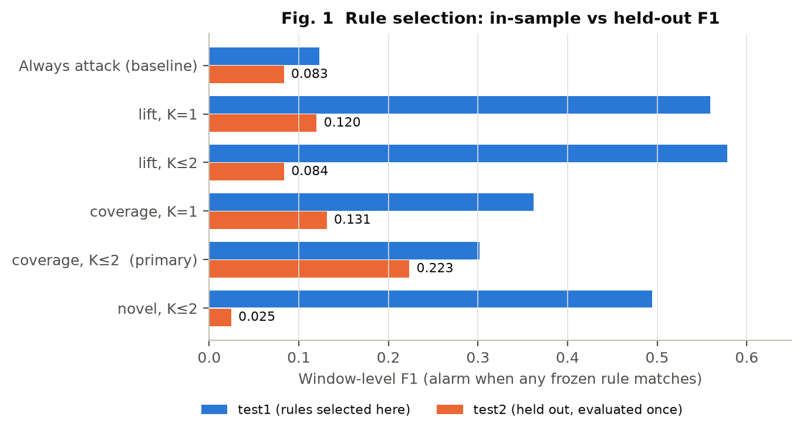
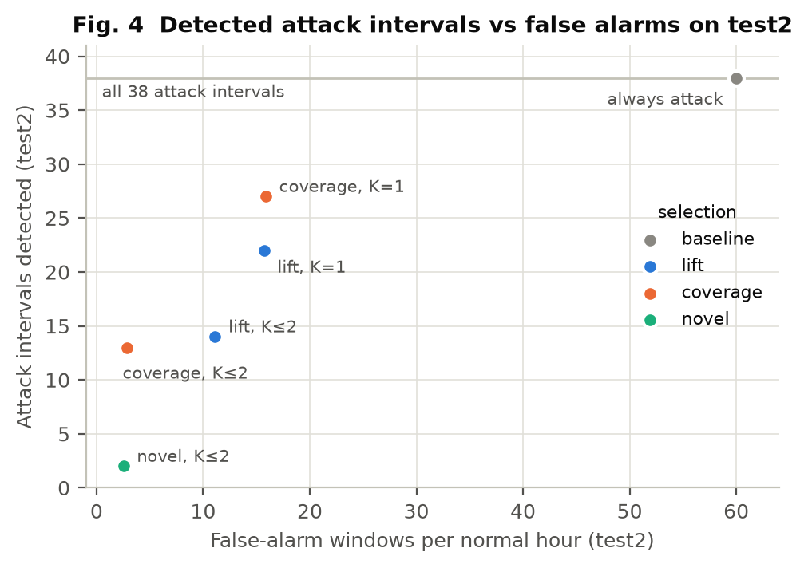
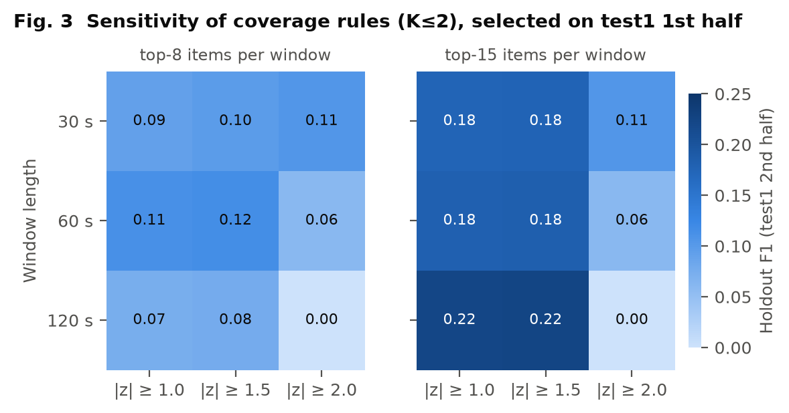
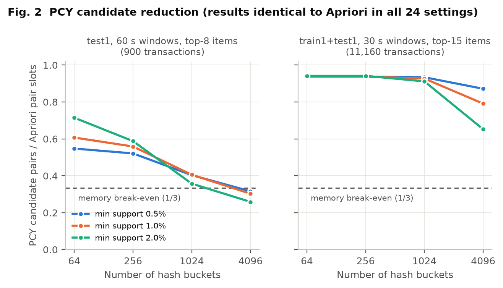

# 보고서 초안: 보안A 파트 (Apriori · 연관 규칙 · PCY)

> **초안 상태 메모 (제출 전 삭제)**
> - 작성: Claude Code (claude-opus-5-5) 초안, 2026-11-27. 본인 검토·수정 필요. `docs/AI_USE_apriori_pcy.md` 참고.
> - 모든 수치는 `results/patterns/*.csv` 에서 옮겼다. 그림은 `python -m experiments.make_figures` 로 재생성된다.
> - 팀 보고서의 절 번호에 맞춰 3.5~3.7, 4.3, 5.3~5.5 에 넣는 것을 가정했다. 통합할 때 번호를 조정한다.
> - `[입력]` 은 본인만 채울 수 있는 부분이다. 강의 슬라이드 쪽 번호는 PDF 쪽 번호로 채웠으니 슬라이드에 인쇄된 번호와 대조할 것.
> - 2026-11-27: 강의자료 대조 후 Interest 지표·강의 예제 테스트·강의 대응 설명을 추가했다 (선택 결과는 그대로).
> - 참고문헌 [8], [9] 는 AI 가 제안한 원 논문이다. **원문을 직접 확인한 뒤** 인용할 것.
> - 팀원 초안의 3.6·5.3·5.4 절(Apriori-pairs, PCY 1,024 버킷, 쌍 규칙 10개)과 내용이 겹친다. 어느 구현·수치를 최종본에 쓸지 팀에서 정한다.

---

## 3.5 창 단위 항목집합 변환

연관 규칙 마이닝은 항목의 집합을 입력으로 받으므로, 연속값 센서 시계열을 이산 항목으로 변환하였다. train1 의 앞 60% (168,480초, 정상 운전) 로 86개 변수 각각의 평균과 표준편차를 구하고, 모든 시점을 z-score 로 바꾸었다. 학습 구간에서 변하지 않는 21개 변수는 표준편차를 1 로 두었다. 이는 PCA·K-means 와 같은 팀 공통 정규화 기준이다.

겹치지 않는 60초 창마다 변수별 평균 z 를 계산하고, |평균 z| ≥ 1.5 인 변수 중 절댓값이 큰 순서로 최대 8개를 골라 `변수=HIGH` (평균 z > 0) 또는 `변수=LOW` 항목으로 만들었다. 창 하나가 거래 하나다. HIGH/LOW 는 "정상 운전 대비 높거나 낮은 통계적 상태"이며 물리적 안전 기준이 아니다. 결과적으로 train1 4,680개, test1 900개, test2 3,840개의 거래를 얻었고, 창당 평균 항목 수는 각각 5.8, 6.2, 7.6개였다. 공격 초가 하나라도 포함된 창을 공격 창으로 정의했으며, test1 은 59개 (6.6%, 공격 구간 14개), test2 는 167개 (4.3%, 공격 구간 38개) 였다.

레이블은 거래를 만드는 데 사용하지 않는다. 규칙 마이닝 단계에서만 공격 창의 거래에 특수 항목 `ATTACK` 을 추가하여 "어떤 센서 상태 조합이 공격 창과 함께 관측되는가"를 정량화한다. 따라서 이 분석은 사후 연관 분석이며, 비지도 탐지기의 입력이나 공격 원인 추정이 아니다.

## 3.6 Apriori 와 연관 규칙 생성

**Apriori** [3], [8] 는 "빈발 집합의 모든 부분집합도 빈발하다"는 단조성 (downward closure) 을 이용해 후보를 줄인다. 구현 (`patterns/apriori.py`) 은 다음 단계를 반복한다.

1. 1차 스캔으로 단일 항목의 지지도를 세어 최소 지지도 이상인 L1 을 만든다.
2. 크기 k−1 빈발 집합 두 개의 합집합 중 크기가 정확히 k 인 것을 후보로 만들고 (join), 그 (k−1)-부분집합 중 하나라도 L(k−1) 에 없으면 버린다 (prune).
3. 데이터를 다시 스캔해 남은 후보의 지지도를 세고 최소 지지도 이상인 것을 L(k) 로 둔다.
4. L(k) 가 비거나 최대 크기에 도달하면 멈춘다.

팀원 구현의 "Apriori-pairs" 와 달리 크기 3 이상의 집합까지 단계적으로 확장한다. 최소 지지도 개수는 ceil(지지도 × 거래 수) 이다.

**연관 규칙** (`patterns/rules.py`) 은 강의의 두 단계 [11, p.17] 를 따른다. 먼저 빈발 집합 I 를 찾고, 크기 2 이상인 I 를 전건 A 와 후건 B = I − A 로 나누어 규칙을 만든다. 규칙의 support 는 양쪽 합집합의 지지도 count(A∪B)/n 이고, confidence = count(A∪B)/count(A), 강의의 Interest = |confidence − P(B)| 이다 [11, pp.12–15]. 보조 지표로 lift = confidence / P(B) 도 함께 보고한다. 단조성 때문에 필요한 모든 개수가 Apriori 결과 안에 있으므로 데이터를 다시 스캔하지 않는다. A∪B 가 빈발해야 규칙이 생성되므로 "support ≥ s" 조건이 보장되고, "confidence ≥ c" 는 최소 confidence 인자로 건다.

본 실험에서는 공격 창에 ATTACK 항목을 붙여 함께 마이닝하고, 후건이 {ATTACK} 인 규칙만 사용했다. 후건이 하나로 고정되면 Interest 와 lift 는 모두 confidence 의 증가함수라서 규칙의 순위가 같다. 공격 창의 기준 비율이 5% 안팎으로 작기 때문에 Interest 는 confidence 와 거의 같은 값이 되고, lift 는 기준 비율 대비 몇 배인지를 보여준다. 구현이 강의 정의와 같은지는 강의 예제 (p.14 의 {m,b}→c: confidence 0.5, Interest 1/8; p.18 의 s=3, c=0.75 규칙 목록; p.40 의 후보 가지치기) 를 단위 테스트로 재현해 확인했다.

## 3.7 PCY

**PCY** [3], [9] 는 Apriori 의 가장 비싼 단계인 쌍 (k=2) 세기의 메모리를 줄인다. 1차 스캔에서 단일 항목을 세는 동시에, 거래 안의 모든 쌍을 해시해 버킷 개수를 센다. 쌍 {i, j} 가 빈발이면 그 버킷의 개수도 최소 count({i, j}) 이상이므로, 개수가 최소 지지도 미만인 버킷의 쌍은 빈발일 수 없다. 2차 스캔에서는 (i, j 모두 빈발) 이고 (해당 버킷이 빈발) 인 쌍만 센다. 구현 (`patterns/pcy.py`) 은 실행마다 값이 바뀌는 파이썬 내장 `hash()` 대신 고정된 CRC32 해시를 사용해 재현성을 확보했다. 빈발 버킷 표시는 bool 리스트로 단순화했으며, 메모리는 아래 4.3 절의 방식으로 추정했다.

**구현 검증.** 강의자료 예제 (p.14, p.18, p.40), 교과서 예제, 무작위 데이터에서 모든 부분집합을 직접 세는 brute-force 결과와의 비교 등 단위 테스트 32개 (Apriori 9, 규칙 14, PCY 9) 를 작성해 모두 통과했다 (거래 변환 테스트 6개 별도). 또한 실제 HAI 데이터에서 규칙 `P1_PCV01D=HIGH & P1_PCV01Z=HIGH → ATTACK` 의 수치 (test1 confidence 0.850, lift 12.97, test2 confidence 0.264, lift 6.06) 가 팀원의 독립 구현 결과와 일치함을 확인했다.

**강의 근거.** 강의자료 DM_03 "Frequent Itemsets & Association Rules" [11] 기준 (PDF 쪽 번호, 슬라이드 인쇄 번호와 대조 필요): 연관 규칙 정의·confidence·Interest·규칙 생성 pp.12–18 (7장), A-Priori pp.33–41 (9장), PCY pp.43–50 (8장, 개선판 Multistage·Multihash pp.51–57). 구현은 강의의 PCY 1차 패스 의사코드 (p.45: 한 번의 스캔에서 항목과 버킷을 함께 셈), 패스 사이 비트맵 (p.47), 2차 패스 조건 (p.48) 을 따랐다. 비트맵은 bool 리스트로 구현했고 실제 1비트 압축은 하지 않았으므로, 메모리는 4.3 절의 방식으로 추정했다.

## 4.3 패턴 분석의 실험 설계

**데이터 분할과 누출 방지.** train1 은 정규화 기준과 "정상에서 나타나는가"를 확인하는 데만 쓴다. 규칙 선택과 모든 설정 결정은 test1 에서만 했다. 개발 단계에서는 test1 을 시간 순서로 반으로 나누어 앞 절반 (450창, 공격 구간 7개) 에서 규칙을 고르고 뒤 절반 (450창, 공격 구간 7개) 에서 검증했다. 최종 단계에서는 test1 전체로 규칙을 골라 고정한 뒤 test2 에서 **한 번만** 평가했다. 창 크기·기준값·항목 수 (60초, 1.5, 8개), 최소 지지도 1%, 고정 규칙 수 10개, 그리고 주 선택 기준은 test2 실행 전에 코드에 기록했다.

**규칙 선택 기준.** 모든 기준에서 규칙의 support (A∪{ATTACK} 의 지지도) 는 최소 지지도 이상이다. 전건 크기의 상한 K ∈ {1, 2, 3, 4} 와 세 가지 선택 기준을 비교했다.
- *lift*: lift 내림차순 (= Interest 내림차순, 팀원 구현과 같은 방식). confidence 기준 없음.
- *coverage*: lift ≥ 2, 즉 confidence ≥ 2·P(ATTACK) (test1 기준 c ≈ 0.131) 인 규칙 중 공격 창을 많이 덮는 순.
- *novel*: coverage 조건에 더해, 전건이 train1 (정상 운전) 에서 한 번도 나타나지 않은 규칙만.

강의의 "Interest 0.5 이상" 기준은 결과 표에 표시만 하고 선택에는 쓰지 않았다. 이 표시는 test2 실행 뒤 강의자료와 대조하면서 추가한 것이며, 선택된 규칙과 평가 수치는 바뀌지 않았다.

coverage 와 novel 은 개발 단계 1차 결과에서 lift 기준이 과적합되는 것을 확인한 뒤 test1 안에서 추가했다. 주 기준은 개발 단계의 민감도 분석 18개 설정에서 평균 holdout F1 이 가장 높은 coverage 로 정했다.

**지표.** 규칙별로 매칭 창 수, confidence, lift (평가 구간의 공격 비율 대비), coverage (공격 창 중 매칭 비율) 를 보고한다. 또한 규칙의 설명력을 하나의 수치로 비교하기 위해, 고정 규칙 중 하나라도 매칭되면 경보로 보고 창 단위 precision·recall·F1, 경보가 하나라도 있는 공격 구간의 수, 정상 1시간당 오경보 창 수를 계산했다. baseline 은 모든 창을 공격으로 보는 규칙 ({} → ATTACK, lift 1) 과 단일 센서 규칙 (K=1) 이다. 이 경보는 독립 탐지기를 제안하는 것이 아니며, 초 단위 PCA·K-means 결과와 직접 비교하지 않는다.

**PCY 비교 프로토콜.** 같은 거래와 같은 최소 지지도에서 Apriori (쌍까지) 와 PCY 를 실행해, 24개 조건 모두에서 결과가 같음을 assert 로 확인했다. 데이터는 (a) test1 60초·상위 8개 (900거래) 와 (b) train1+test1 30초·상위 15개·기준 1.0 (11,160거래) 두 가지, 최소 지지도는 0.5%·1%·2%, 버킷 수는 64·256·1,024·4,096 이다. 레이블은 쓰지 않는다. 주 지표는 실행 시간이 아니라 2차 스캔에서 세는 후보 수와 추정 메모리다. 교재 [3] 의 방식대로, Apriori 는 빈발 항목 m 개의 모든 쌍 C(m,2) 칸을 삼각행렬 (쌍당 4바이트) 로 세고, PCY 는 후보가 흩어져 있어 triples (쌍당 12바이트) 와 버킷 비트맵 (버킷당 1비트) 이 필요하다고 보았다. 따라서 PCY 는 후보를 삼각행렬 칸 수의 1/3 미만으로 줄여야 메모리에서 이득이다. 실행 시간은 참고용으로 보고한다.

**실행 환경.** Python 3.14.4, numpy 2.5.5, pandas 3.1.1, matplotlib 3.11.2, Windows 11. 팀원 환경 (numpy 2.3.5, pandas 2.2.3) 은 Python 3.14 용 배포판이 없어 최신판을 사용했다. 실행 명령은 README 에 있다.

## 5.3 공격 관련 규칙: 고른 구간과 처음 보는 구간

**표 A. test2 결과 (test1 전체에서 규칙 10개를 골라 고정).**

| 선택 기준 | precision | recall | F1 | 검출 공격 구간 | 정상 1시간당 오경보 창 |
|---|---:|---:|---:|---:|---:|
| 항상 공격 (baseline) | 0.043 | 1.000 | 0.083 | 38/38 | 60.0 |
| lift, K=1 | 0.070 | 0.431 | 0.120 | 22/38 | 15.7 |
| lift, K≤2 | 0.052 | 0.222 | 0.084 | 14/38 | 11.1 |
| coverage, K=1 | 0.076 | 0.479 | 0.131 | 27/38 | 15.9 |
| **coverage, K≤2 (주 기준)** | **0.197** | 0.257 | **0.223** | 13/38 | **2.9** |
| novel, K≤2 | 0.025 | 0.024 | 0.025 | 2/38 | 2.5 |

lift 기준은 규칙을 고른 구간에서 성능이 가장 높았지만 (test1 F1 0.578, K≤2) 처음 보는 구간에서는 baseline 수준으로 떨어졌다 (test2 F1 0.084). 개발 단계에서는 더 극단적이어서, K≥2 의 lift 규칙은 test1 앞 절반에서 precision 1.0 이었으나 뒤 절반에서는 한 번도 매칭되지 않았다. lift 순으로 고르면 confidence 1.0 인 규칙이 상위를 차지하는데, 이런 규칙은 대부분 특정 공격 시나리오 하나에서만 나타나는 조합이었다. 전건이 길수록 더 구체적이어서 이 현상이 심했다 (개발 단계 holdout F1: K=1 0.233, K≥2 모두 0).

미리 정한 주 기준인 coverage (K≤2) 는 test2 에서 F1 0.223 으로 가장 높았고, 오경보는 lift (K≤2) 의 약 1/4 이었다. 공격 창을 많이 덮는 규칙을 우선하면 여러 공격 구간에 공통인 상태가 선택되어, 다른 날짜의 데이터에도 더 잘 옮겨갔다. 반면 novel 기준은 실패했다. "정상 운전에서 한 번도 안 나온 조합"이라는 조건이 다시 특정 공격 전용 조합만 남겼기 때문이다.

**표 B. 주 기준 (coverage, K≤2) 으로 고정한 규칙 10개.** 규칙 지지도 = test1 에서 전건과 ATTACK 이 함께 나온 창 수 (최소 지지도 9창). train1 = 정상 운전 4,680창에서 전건이 나타난 횟수. Interest = |confidence − P(ATTACK)| (P(ATTACK): test1 0.066, test2 0.043).

| # | 전건 → ATTACK | 규칙 지지도 | train1 | test1 conf / Interest / lift | test2 매칭 | test2 conf / Interest / lift |
|---:|---|---:|---:|---:|---:|---:|
| 1 | P1_PCV01D=HIGH | 18 | 183 | 0.818 / 0.753 / 12.5 | 118 | 0.212 / 0.168 / 4.9 |
| 2 | P1_PCV01Z=HIGH | 18 | 177 | 0.720 / 0.654 / 11.0 | 116 | 0.233 / 0.189 / 5.4 |
| 3 | P1_PCV01D=HIGH & P1_PCV01Z=HIGH | 17 | 155 | 0.850 / 0.784 / 13.0 | 91 | 0.264 / 0.220 / 6.1 |
| 4 | P1_LCV01Z=LOW | 16 | 191 | 0.222 / 0.157 / 3.4 | 63 | 0.190 / 0.147 / 4.4 |
| 5 | P1_LCV01D=LOW | 16 | 186 | 0.213 / 0.148 / 3.3 | 68 | 0.221 / 0.177 / 5.1 |
| 6 | P1_LCV01D=LOW & P1_LCV01Z=LOW | 15 | 164 | 0.242 / 0.176 / 3.7 | 49 | 0.163 / 0.120 / 3.8 |
| 7 | P1_PIT01=HIGH | 13 | 134 | 0.684 / 0.619 / 10.4 | 38 | 0.421 / 0.378 / 9.7 |
| 8 | P1_LCV01D=LOW & P1_PCV01D=HIGH | 12 | 18 | 1.000 / 0.934 / 15.3 | 8 | 0.625 / 0.582 / 14.4 |
| 9 | P1_LCV01D=LOW & P1_PCV01Z=HIGH | 12 | 21 | 1.000 / 0.934 / 15.3 | 10 | 0.500 / 0.457 / 11.5 |
| 10 | P1_PCV01D=HIGH & P1_PIT01=HIGH | 12 | 65 | 1.000 / 0.934 / 15.3 | 21 | 0.381 / 0.337 / 8.8 |

**강의의 Interest 기준과의 관계.** 강의는 Interest 가 보통 0.5 이상인 규칙을 흥미롭다고 본다 [11, p.13]. test1 기준으로 lift (= Interest) 기준이 고른 규칙 10개 (K≤2) 는 모두 Interest ≥ 0.5 였지만, test2 에서는 F1 0.084 로 baseline 수준이었다. 반대로 주 기준 규칙 중 3개 (#4–#6, LCV01 계열) 는 Interest 가 0.15–0.18 로 0.5 에 못 미쳤지만, test2 에서도 lift 3.8–5.1 을 유지했다. 기준 비율이 4–7% 인 드문 후건에서는 Interest ≈ confidence 가 되어, "Interest ≥ 0.5" 가 사실상 "confidence ≥ 0.57" 과 같아진다. 이 조건은 특정 공격 하나에만 나타나는 고확신 규칙을 선호하게 되어 일반화에 불리했다.

고정한 10개 규칙은 모두 test2 에서도 lift 3.75 이상을 유지했다. 즉 P1 공정의 압력 조절 밸브 (PCV01) 와 수위 조절 밸브 (LCV01), 압력 (PIT01) 이 정상 대비 벗어난 상태는 날짜가 달라도 공격 창과 우연보다 자주 함께 나타났다. 다만 confidence 는 대부분 낮아졌고 (예: 규칙 3 은 0.850 → 0.264, 규칙 8 은 1.000 → 0.625), 공격 창 coverage 는 규칙당 3~16% 에 그쳤다. 규칙 대부분이 P1 공정의 같은 밸브 계열이어서, 다른 공정이나 변수를 조작한 공격 (38개 구간 중 25개) 은 설명하지 못했다. K=1 기준에서 선택된 `P1_FT03=HIGH` 는 test1 에서 confidence 1.0 이었으나 test2 에서는 lift 0.93 으로 우연 수준이었다. 이 상태는 train1 정상 운전에서도 1,118회 나타났다. 정상에서 흔한 상태는 날짜가 바뀌면 정상 운전 변화로도 나타나 오경보의 원인이 된다는 것을 보여준다.

## 5.4 민감도 분석

창 크기 (30·60·120초), 기준값 (1.0·1.5·2.0), 창당 최대 항목 수 (8·15) 의 18개 조합을 test1 안에서만 비교했다. 세 선택 기준의 holdout F1 평균은 coverage 0.115, lift 0.067, novel 0.006 이었다. 기준값 2.0 은 항목이 너무 적어 (창당 평균 3.7~4.0개) 성능이 낮았고, 기준값 1.0·1.5 에서 항목 수를 15개로 늘리면 holdout F1 이 0.18~0.22 로 올랐다 (8개일 때 0.07~0.12). 그러나 기준값 1.0·항목 15개에서는 빈발 집합이 최대 45,153개로 늘어 마이닝 시간이 53초로 증가했다. 가장 좋은 설정에서도 holdout F1 은 0.234 에 그쳐, 파라미터보다 공격 종류의 차이가 일반화를 제한하는 주된 요인으로 판단된다. 이 결과는 test2 실행 전에 기본 설정을 바꾸는 데 사용하지 않았다.

## 5.5 PCY 와 Apriori 의 효율

24개 조건 모두에서 PCY 의 빈발 쌍은 Apriori 와 완전히 같았다. 후보 감소율은 5.9~74.1% 였지만, 추정 메모리에서 PCY 가 이긴 조건은 1개 (test1, 지지도 2%, 버킷 4,096개: 후보 820칸 → 212개, 3,280 → 3,056바이트) 뿐이었다. 큰 데이터에서는 버킷 64·256개일 때 모든 버킷이 빈발이 되어 아무 쌍도 거르지 못했고, 4,096개에서도 감소율이 13~35% 였다. 이 데이터에서는 가능한 쌍 5,151개 중 3,804개 (지지도 0.5%) 가 실제로 빈발했다. 공정상 물리적으로 연결된 센서들이 함께 정상 범위를 벗어나기 때문에, "대부분의 쌍은 드물다"는 PCY 의 전제가 HAI 데이터에는 잘 맞지 않는다.

실행 시간은 이번 구현에서 PCY 가 더 짧았지만 (큰 데이터 기준 Apriori 16.1~18.9초, PCY 4.6~5.9초), 이는 Apriori 의 후보 세기를 "거래마다 모든 후보를 검사"하는 방식으로 구현했기 때문이다. 팀원 구현에서는 반대로 PCY 가 느렸다. 실행 시간은 반복 실행마다 달라졌으며 하드웨어를 고정하지 않았으므로, 알고리즘의 속도 차이로 해석하지 않는다.

## 6. (보안A 파트) 결론과 한계 — 팀 결론 절에 합칠 문장

- 연관 규칙은 학습한 공격이 어떤 센서 상태와 함께 나타나는지 설명하는 데 유용했다. 주 기준으로 고정한 규칙 10개는 다른 날짜의 test2 에서도 lift 3.75 이상을 유지했다.
- 그러나 lift 순으로 고른 규칙은 특정 공격 시나리오에 과적합되어 처음 보는 구간에서 baseline 수준으로 떨어졌다. 공격 창을 많이 덮는 규칙을 우선하면 일반화가 개선되었지만 (test2 F1 0.084 → 0.223), 다른 종류의 공격은 여전히 설명하지 못했다.
- PCY 는 결과를 바꾸지 않고 후보를 최대 74% 줄였으나, 센서 상태의 동시 출현이 조밀한 HAI 데이터에서는 메모리 이득이 거의 없었다.
- 한계: 공격 창 표본이 작다 (test1 59창, 공격 구간 14개). 창 레이블은 공격 초가 하나만 있어도 1 이다. test2 레이블은 분 단위 기록이라 행 순서 대응을 가정했다. HIGH/LOW 는 통계적 상태이며 물리적 의미는 공식 기술 문서로 확인하지 않았다. 규칙은 동시 출현일 뿐 인과가 아니다.
- 향후 과제 (test2 를 본 뒤의 아이디어이므로 새 데이터로 검증해야 함): 정상 운전에서의 출현 빈도로 규칙에 감점을 주는 완화된 대조 기준, 공격 종류별 규칙 분석, confidence 기반 규칙 가지치기.

## AI 사용 공개 (보안A 파트) — 팀 공개란에 합칠 문장

Anthropic 의 Claude Code (모델 claude-opus-5-5) 를 2026-11-25~27 에 사용하였다. 과제 요구사항 분석, 함수 뼈대와 단위 테스트 작성, Apriori 구현 코칭 (본문은 본인 작성, while 루프 일부 빈칸은 AI 가 제시), 연관 규칙·PCY·거래 변환·실험·그림 코드 작성, 결과 해석과 본 절의 초안 작성에 도움을 받았다. 영향 받은 파일은 `patterns/`, `tests/`, `experiments/`, `results/patterns/`, `docs/` 이다. 출력은 강의자료 예제를 포함한 단위 테스트 38개, 팀원 독립 구현과의 규칙 수치 대조, 강의자료 정의와의 대조, 결과 CSV 와 본문 수치의 대조, [입력: 본인이 직접 한 검토 — 예: 코드 정독, 손 계산 검산] 으로 확인하고 [입력: 본인이 수정한 내용] 을 수정하였다. 파일별 상세 내역은 저장소의 `docs/AI_USE_apriori_pcy.md` 에 있다.

## 추가 참고문헌 (팀 목록에 번호를 맞춰 추가)

[8] R. Agrawal and R. Srikant, "Fast algorithms for mining association rules," in *Proc. 20th Int. Conf. Very Large Data Bases (VLDB)*, 1994, pp. 487–499. **[원문 확인 필요]**

[9] J. S. Park, M.-S. Chen, and P. S. Yu, "An effective hash-based algorithm for mining association rules," in *Proc. ACM SIGMOD Int. Conf. Management of Data*, 1995, pp. 175–186. **[원문 확인 필요]**

[11] 이슬 (Sael Lee), "Data Mining: Frequent Itemsets & Association Rules (DM_03)," 아주대학교 소프트웨어학과 SCE331 강의자료, 슬라이드 출처 J. Leskovec, A. Rajaraman, J. D. Ullman, MMDS (http://www.mmds.org).

[10] Matplotlib 3.11.2 / pandas 3.1.1 / NumPy 2.5.5 — 팀 목록 [4]~[6] 의 버전 표기를 이 파트 실행 환경에 맞게 수정할 것.
